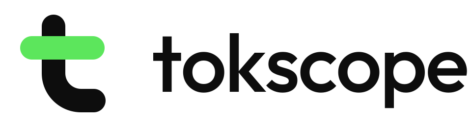
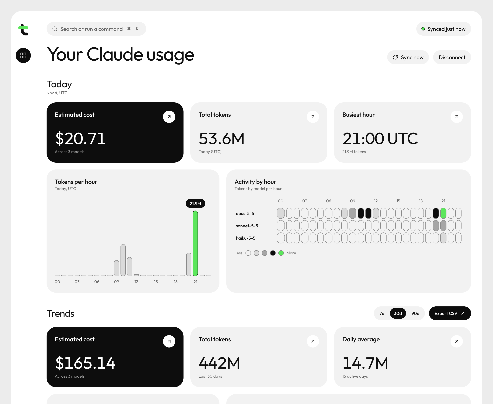
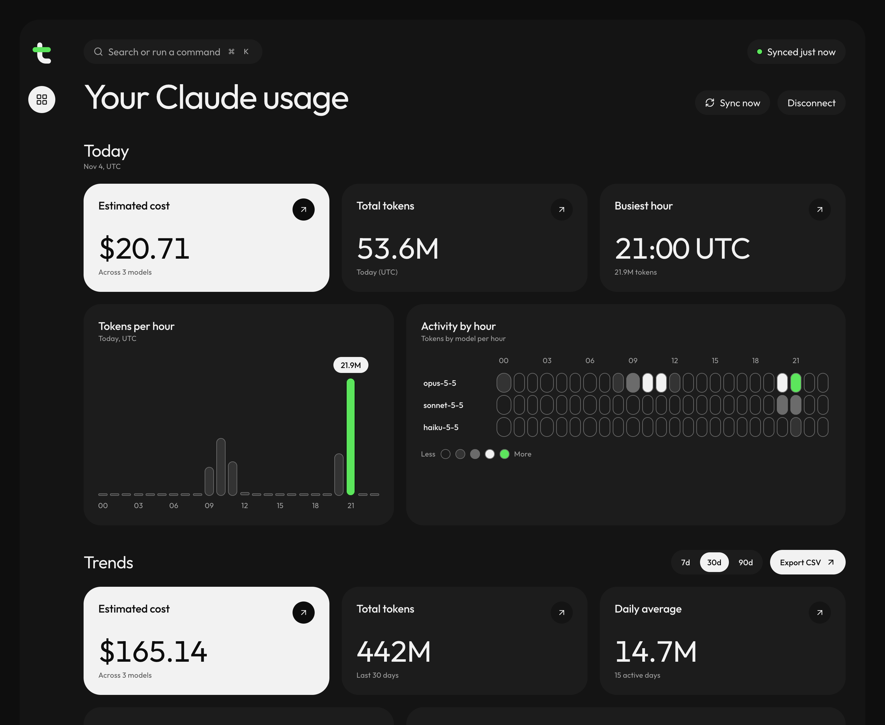
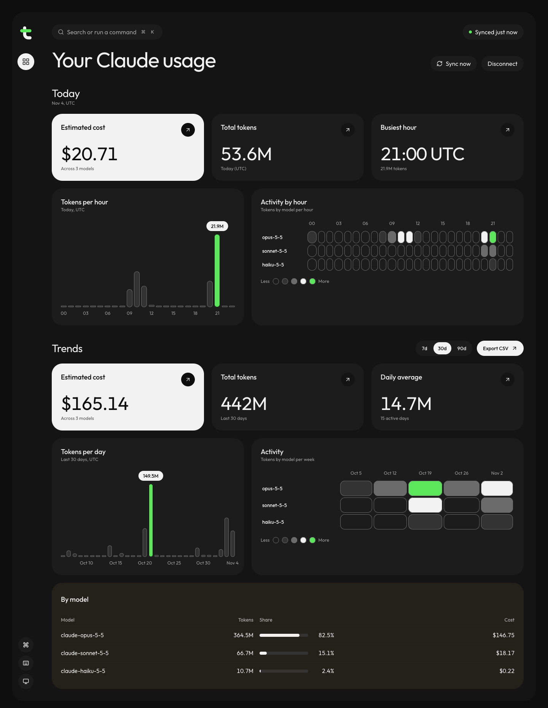

<p align="center">
  <picture>
    <source media="(prefers-color-scheme: dark)" srcset="docs/brand/tokscope-horizontal-reversed.svg" />
    
  </picture>
</p>

# tokscope: Claude Code usage and cost dashboard

tokscope is a free, open-source, self-hosted dashboard that reads your local Claude Code transcripts and shows how many tokens you used today, per hour, per day and per model (Opus, Sonnet, Haiku), with an estimated API cost.

It runs on 127.0.0.1, mounts your transcripts read-only, makes no LLM calls, and no data leaves your machine.

[](https://github.com/albkhachikyan/tokscope/actions/workflows/ci.yml)
[](LICENSE)


<picture>
  <source media="(prefers-color-scheme: dark)" srcset="docs/screenshot-dark.png" />
  
</picture>

## Why

Claude Code does not show how many tokens you spend per day or per hour. If you are on a subscription (Pro, Max, Team), you are not billed per token, but you may still want to know what the same usage would cost at Anthropic API pricing. tokscope is a local-first token tracker that answers both questions from files already on your disk.

## Features

- **Today section, always on top:** today's estimated cost and total tokens, the busiest hour, tokens per hour (UTC), and a model by hour heatmap. It is the first thing you see when you open the dashboard.
- **Trends section below it:** a 7, 30 or 90 day range (30 by default) with cost, total tokens, daily average, tokens per day and a model by week heatmap.
- Per-model breakdown (Opus, Sonnet, Haiku) with cost share.
- Input, output, cache read and cache write tokens accounted separately.
- Dedup of streamed messages: the maximum token counts per message are kept.
- Estimated cost from a built-in price table. Unknown models show `—` instead of a guessed number.
- Light and dark theme that follows your system setting.
- ⌘K command palette and single-key shortcuts.
- CSV export of the usage data.
- Background sync every 60 seconds.

## Screenshots

Today section, dark theme:



Full dashboard, dark theme (Today on top, 30-day Trends below):



## How it works

```
~/.claude/projects (read-only mount)
        │  incremental jsonl parse
        ▼
FastAPI backend ── SQLite (/data/usage.db, WAL) ── REST /api/*   [internal docker network only]
        ▲
        │  server-side fetch + Server Actions (no CORS; browser never calls backend)
Next.js frontend → 127.0.0.1:3000
```

- **Connect:** the backend reads `~/.claude/projects/**/*.jsonl` read-only and runs a first sync into SQLite.
- Claude Code streams each assistant message across several lines that share one `message.id`. The parser dedups by message id and keeps the final (maximum) token counts, not the first partial line.
- A background sync runs every 60 seconds (`SYNC_INTERVAL_S`). Only new bytes are parsed, and each file's offset advances only to the last complete line.
- Hours and days are in UTC.

### API

Endpoints: `/api/health`, `/api/connection`, `/api/sync`, and `/api/usage?days=1..365`, which includes the `hourly` breakdown for today. The backend is reachable only inside the Docker network; the browser never calls it.

## Quickstart

Requires Docker, [uv](https://docs.astral.sh/uv/), and pnpm.

```sh
cp .env.example .env
make install
make up
```

Open http://127.0.0.1:3000 and click **Connect**.

If port 3000 is already in use, set `FRONTEND_PORT` in `.env` (for example `FRONTEND_PORT=3002`) and open the matching port, such as http://127.0.0.1:3002.

## Configuration

Copy `.env.example` to `.env`. Every variable has a safe default.

| Variable              | Default               | Description                                                  |
| --------------------- | --------------------- | ------------------------------------------------------------ |
| `CLAUDE_PROJECTS_DIR` | `/claude/projects`    | Transcript path inside the backend container.                |
| `DB_PATH`             | `/data/usage.db`      | SQLite file inside the backend container (kept in a volume). |
| `SYNC_INTERVAL_S`     | `60`                  | Background sync interval in seconds (10 to 3600).            |
| `LOG_LEVEL`           | `INFO`                | `DEBUG`, `INFO`, `WARNING`, or `ERROR`.                      |
| `BACKEND_URL`         | `http://backend:8000` | Backend URL used by the frontend server side only.           |
| `FRONTEND_PORT`       | `3000`                | Host port for the frontend, bound to `127.0.0.1`.            |

## Keyboard shortcuts

| Keys        | Action                              | Single-key?    |
| ----------- | ----------------------------------- | -------------- |
| ⌘K / Ctrl+K | Open command palette                | no (always on) |
| `/`         | Open command palette                | yes            |
| `s`         | Sync now                            | yes            |
| `1` `2` `3` | 7 / 30 / 90 days (Trends range)     | yes            |
| `e`         | Export CSV                          | yes            |
| `t`         | Cycle theme (system → light → dark) | yes            |
| `?`         | Shortcuts dialog                    | yes            |
| Esc         | Close overlay                       | —              |

Connect and Disconnect have no shortcut; they are available only from the palette or the button. Hints are rendered with shadcn `Kbd`, showing ⌘ on macOS and Ctrl elsewhere.

Single-key shortcuts can be turned off in the shortcuts dialog (`?`).

## FAQ

### How do I see my Claude Code token usage?

Run tokscope, open http://127.0.0.1:3000 and click Connect. It imports the transcripts Claude Code already writes to `~/.claude/projects` and shows token usage per hour, day and model.

### How much would my Claude Code usage cost on the API?

The dashboard multiplies your input, output, cache read and cache write tokens by Anthropic API prices per model and shows the total for today and for 7, 30 and 90 days. This is useful on Pro, Max or Team plans, which are not billed per token.

### Does tokscope send my data anywhere?

No. It reads transcripts through a read-only mount, stores data in a local SQLite file, and makes no LLM calls. The frontend binds to `127.0.0.1` and the backend port is not published.

### Is the cost exact?

No. It is an estimate for comparison, not a billing record. Prices are a hard-coded table and may differ from your actual invoice or plan terms.

### Which models are supported?

Prices for the Opus, Sonnet and Haiku families are hard-coded in `backend/app/services/pricing_service.py`. Models without a known price still count tokens, and their cost shows `—`.

### Why are hours and days in UTC?

Transcript timestamps are stored in UTC, so grouping by UTC keeps results the same regardless of your timezone or where the container runs. The Today section therefore shows the current UTC day.

## Design

Design rules live in [`DESIGN.md`](DESIGN.md): tokens, components, accessibility (WCAG 2.2 AA), and motion. Motion respects reduced-motion settings. The UI is built with shadcn/ui and uses Tailwind v4 tokens only. Charts are server-rendered.

## Development

| Command      | Purpose                                                       |
| ------------ | ------------------------------------------------------------- |
| `make lint`  | ruff, ruff format check, mypy, eslint, prettier, steiger, tsc |
| `make fmt`   | Autofix formatting and lint                                   |
| `make test`  | pytest (coverage gate 85%) and vitest                         |
| `make graph` | Rebuild the code graph (graphify, no LLM)                     |

Git hooks are managed by Husky:

- `pre-commit`: lint-staged (eslint and prettier for frontend, ruff for backend)
- `commit-msg`: commitlint
- `pre-push`: `make lint test`

Commits follow [Conventional Commits](https://www.conventionalcommits.org/) (`feat:`, `fix:`, `chore:`, `test:`, `docs:`, `refactor:`, `ci:`).

## Security

- The transcripts directory is mounted read-only (`:ro`). The app never writes to `~/.claude`.
- The backend port is not published. Only the frontend is exposed, and only on `127.0.0.1`.
- Containers run as non-root users.
- No data leaves your machine. The app makes no LLM calls.

## Cost estimates

- Prices are hard-coded in `backend/app/services/pricing_service.py` (USD per million tokens).
- Costs are estimates for comparison, not billing records.
- Subscription plans (Pro, Max, Team) are not billed per token, so the estimate shows what the same usage would cost at API rates.

## Project structure

```
backend/app/
├── controllers/   # FastAPI routers (thin)
├── services/      # business logic (sync, parsing, usage, pricing)
├── repositories/  # SQL only (sqlite3)
├── core/          # config, database, errors
├── schemas/       # Pydantic IO models
└── domain/        # frozen dataclass entities
frontend/src/
├── app/           # Next.js routing only
├── views/         # pages
├── widgets/       # composed UI blocks
├── features/      # user actions (server actions)
├── entities/      # business entities
└── shared/        # api, config, lib, ui
```

Backend follows MVC with services and repositories. Frontend follows Feature-Sliced Design (FSD).

## Contributing

Issues and pull requests are welcome. Use Conventional Commits, and make sure `make lint test` passes before you push.

If tokscope is useful to you, a star on GitHub helps others find it.

## Brand

The logo, colours and usage rules are in [`docs/brand`](docs/brand/README.md).

## License

[MIT](LICENSE)
