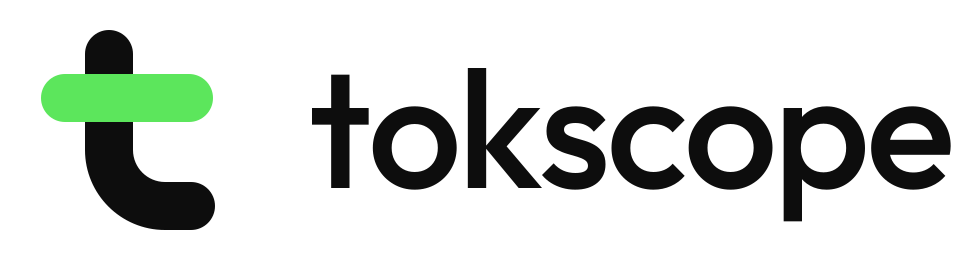

# tokscope logo: usage guide

<picture>
  <source media="(prefers-color-scheme: dark)" srcset="tokscope-horizontal-reversed.svg" />
  
</picture>

## The idea

A lowercase **t** drawn from two of the dashboard's own chart bars: an ink stem with a tail, crossed by a **green bar**. The green crossbar is the one ownable detail. It is the same pill shape as the bars in tokscope's charts, so the logo and the product share one form.

**Construction:** a 256 grid with one 48-unit stroke. Radii are 24 (caps), 32 (inner tail) and 80 (outer tail). The crossbar is 172 × 48, placed 74 units from the top.

## Files

| File                                            | Use                                                     |
| ----------------------------------------------- | ------------------------------------------------------- |
| `tokscope-horizontal.svg` / `-reversed.svg`     | Default lockup: README, site header, slides             |
| `tokscope-stacked.svg` / `-reversed.svg`        | Square-ish spaces: posters, title slides                |
| `tokscope-symbol.svg` / `-reversed.svg`         | Symbol alone, once the name is already visible          |
| `tokscope-symbol-small.svg`                     | Tight crop for 16-32 px                                 |
| `tokscope-app-icon.svg`                         | Favicon, app icon, GitHub/LinkedIn avatar (ink tile)    |
| `tokscope-wordmark.svg` / `-reversed.svg`       | Name only, where the symbol already appears nearby      |
| `tokscope-*-black.svg`, `-white.svg`, `-mono-*` | One-colour reproduction (print, embossing, stamps)      |
| `web/`                                          | `favicon.ico` (16/32/48), PNG icons 16-512, apple-touch |
| `png/`                                          | 1200 px lockups, 1024 px avatar                         |
| `board/`                                        | Presentation slides with mockups                        |

The wordmark is built from **Outfit Medium** (SIL Open Font License), converted to outlines. It is the same family the app uses.

## Colour

| Role         | HEX       | RGB         | CMYK (approx.) | Notes                                                        |
| ------------ | --------- | ----------- | -------------- | ------------------------------------------------------------ |
| Brand green  | `#5CE65C` | 92 230 92   | 60 0 80 0      | Crossbar only. Pantone: match on press (try 802 C / 7479 C). |
| Ink          | `#0D0D0D` | 13 13 13    | 0 0 0 95       | Stem and wordmark on light backgrounds; app-icon tile        |
| Paper        | `#FFFFFF` | 255 255 255 | 0 0 0 0        | Stem and wordmark on dark backgrounds                        |
| Dark surface | `#141414` | 20 20 20    | 0 0 0 92       | The app's dark background, tested with the reversed lockup   |

The green is a graphic accent. Never use it for text on white (contrast 1.6:1).

## Clear space and minimum size

- **Clear space:** the height of the crossbar (48 units, about 19% of the symbol height) on every side.
- **Minimum size:** symbol 16 px (use `tokscope-symbol-small.svg` or the app icon below 32 px). Horizontal lockup 96 px wide (screen) or 20 mm (print).

## Backgrounds

- Light (white, `#F2F2F2`): standard version, with an ink stem and wordmark.
- Dark (`#0D0D0D` to `#1C1C1C`): reversed version, with a white stem and wordmark. The crossbar stays green.
- Photos or busy backgrounds: use the app-icon tile, or the one-colour white version on a dark scrim.

## Don't

- Recolour the crossbar, or make the stem green too (the two-colour split is the idea).
- Stretch, rotate, outline, add shadows or gradients.
- Rebuild the wordmark in another font, or change its letter spacing.
- Put the green crossbar on a green or mid-grey background.
- Add a star or asterisk. tokscope stays clearly separate from Claude's own mark.

## Legal

No trademark search has been done. Before wider commercial use, search USPTO/EUIPO and run a reverse image search. The rounded lowercase "t" lives near other t-marks, so the green bar crossbar is what makes it distinctive.
